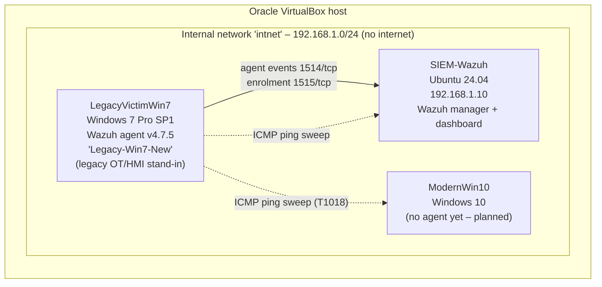

# Wazuh SOC Lab – Legacy Windows host monitoring (IT/OT-inspired)

> **Svensk sammanfattning:** Det här är mitt hemmalabb från maj 2026, byggt i VirtualBox som en del av mitt examensarbete på YH-utbildningen IT-säkerhetstekniker (Edugrade, juni 2026) om incidenthantering i hybrida IT/OT-miljöer med Wazuh och MITRE ATT&CK. Labbet består av en Wazuh-server på Ubuntu 24.04 och två Windows-klienter på ett isolerat internt nät. En äldre Windows 7-maskin får symbolisera den typ av äldre värd (t.ex. HMI/ingenjörsstation) som ofta finns kvar i industrimiljöer – det är **inga riktiga OT-enheter** i labbet. Repot dokumenterar installationen, felsökningen av agentanslutningen, en ping-svep (spaning, MITRE T1018) och en filintegritetslarm (Wazuh-regel 550, MITRE T1565.001). Allt bygger på mina egna skärmdumpar; det som inte är gjort än är markerat som *planerat*.

---

## 1. Overview

A small, isolated SOC lab built in **Oracle VirtualBox** (21–27 May 2026) to practise the defender workflow end to end:

1. deploy a SIEM (Wazuh) on Linux,
2. enrol an endpoint agent on an old, unsupported Windows host,
3. troubleshoot the agent connection,
4. generate attacker-like activity and file changes,
5. read the resulting alert and map it to **MITRE ATT&CK**.

The lab is part of my YH thesis (IT-säkerhetstekniker, Edugrade, June 2026) on incident handling in hybrid IT/OT environments with Wazuh and MITRE ATT&CK.

**Why Windows 7?** Industrial environments often still run legacy Windows on HMIs and engineering workstations because vendor software is certified for a specific OS. The `LegacyVictimWin7` VM is a *stand-in* for that kind of host. The lab contains no PLCs, no industrial protocols and no real OT equipment.

Everything below is based on my own screenshots in [`screenshots/`](screenshots/). Nothing has been added that I did not do; future work is marked **(planned)**.

## 2. Architecture



| VM | OS | IP | Role |
|---|---|---|---|
| SIEM-Wazuh | Ubuntu 24.04 | 192.168.1.10 | Wazuh server (manager, Filebeat, dashboard on the same VM) |
| LegacyVictimWin7 | Windows 7 Professional SP1 (build 6.1.7601) | 192.168.1.20 or .30 (see note) | Monitored endpoint, Wazuh agent `Legacy-Win7-New` |
| ModernWin10 | Windows 10 (Swedish UI) | 192.168.1.20 or .30 (see note) | Second Windows host, discovery target |

*Note:* the ping sweep shows two Windows hosts at .20 and .30 (TTL 128). My screenshots do not show which VM has which of the two addresses, so I have not guessed.

## 3. Lab setup (summary – details in [`docs/setup.md`](docs/setup.md))

- **Network:** VirtualBox *Internal Network* named `intnet`, promiscuous mode *Allow All* (shown for the Win7 VM). The VMs have no internet access on this adapter. ([screenshot](screenshots/01-virtualbox-snapshots-intnet.png))
- **Snapshots:** taken at each working milestone (names in Swedish), e.g. *"Windows 7 installerad klar"*, *"Agent Grön-Nätverk funkar"* (agent green, network works), *"ping funkar"*, so I could roll back after experiments.
- **Wazuh server:** installed on Ubuntu 24.04 on 22 May 2026 (installation finished 13:43:39). The installer log shows Filebeat and the Wazuh dashboard being installed and the dashboard being reachable on port 443. Local user `socadmin`. ([redacted screenshot](screenshots/04-wazuh-install-summary-REDACTED.png))
- **Agent:** Wazuh agent v4.7.5 on Windows 7, configured to report to `192.168.1.10:1514/tcp`. ([screenshot](screenshots/09-agent-ossec-conf-server.png), [config excerpt](config/ossec-agent-excerpt.xml))
- **FIM:** a real-time, `check_all` directory watch on `C:\Users\LegacyUser\Desktop\HEMLIGT` ("HEMLIGT" = "SECRET"), used as a fake "sensitive data" folder. ([screenshot](screenshots/10-agent-ossec-conf-fim-hemligt.png))

## 4. Mini incident log – agent enrolment failure (24 May 2026)

Full notes: [`docs/troubleshooting.md`](docs/troubleshooting.md)

| Time (lab clock) | Observation / action | Evidence |
|---|---|---|
| 14:45:11 | Manual key request with `agent-auth` to 192.168.1.10, agent name `Legacy-Win7-New` → *"Valid key received"* (no enrolment password used) | [05](screenshots/05-agent-auth-manual-key-and-restart.png) |
| ~14:52 | `net start Wazuh` → already running; `net stop Wazuh` / `net start Wazuh` to reload the new key | [05](screenshots/05-agent-auth-manual-key-and-restart.png) |
| (time not shown) | Dashboard shows the agent as **Disconnected (1)**, coverage 0.00 % | [07](screenshots/07-dashboard-agent-disconnected.png) |
| 16:48–16:51 | `ossec.log`: repeated **ERROR (1216)** *unable to connect to 192.168.1.10:1514/tcp* (connection refused) and **ERROR (1208)** *unable to connect to enrollment service at 192.168.1.10:1515*; WARNING (4101) *waiting for server reply* | [06](screenshots/06-agent-ossec-log-1216-1208-then-connected.png) |
| 16:51:31 | **INFO (4102): Connected to the server (192.168.1.10:1514/tcp)**; modules start (syscollector, event-log reading of Application/Security/System, rootcheck, FIM with 43200 s scan frequency) | [06](screenshots/06-agent-ossec-log-1216-1208-then-connected.png) |
| afterwards | Dashboard: **Active (1)**, coverage **100.00 %** | [08](screenshots/08-dashboard-agent-active.png) |

**How I worked it:** confirmed basic reachability with ping to 192.168.1.10 (replies, TTL 64 = Linux; [screenshot 12](screenshots/12-powershell-ping-siem.png)) → isolated the problem to the Wazuh ports 1514/1515 rather than the network → re-requested the agent key → restarted the agent service → watched `ossec.log` until the 4102 "Connected" message → verified in the dashboard.

**Honest note on root cause:** "connection refused" means the server VM was reachable but nothing accepted the connection on 1514/1515 at that moment (manager service not listening yet, or a firewall). My screenshots show the symptoms and the fix sequence, but not the exact server-side cause, so I don't claim one.

## 5. Detection case 1 – Network discovery with a ping sweep (26 May 2026)

From an Administrator `cmd.exe` on **LegacyVictimWin7** I simulated an attacker who has landed on the legacy host and maps the network:

```bat
for /L %i in (1,1,254) do @ping -n 1 -w 100 192.168.1.%i | find "Reply"
```

- The first attempts failed with `FIND: Parameter format not correct` because of wrong quoting of the `find` string; after fixing the quotes the loop worked.
- Result of the final run: **192.168.1.10 (TTL 64 → Linux, the SIEM)**, **192.168.1.20 and 192.168.1.30 (TTL 128 → Windows)**. ([screenshot](screenshots/11-win7-ping-sweep.png))
- A separate PowerShell ping to 192.168.1.10 succeeded with 0 % loss. ([screenshot](screenshots/12-powershell-ping-siem.png))

**MITRE ATT&CK mapping:** **T1018 – Remote System Discovery** (tactic: Discovery). A ping sweep finds *which hosts are alive*. I deliberately did **not** map it to T1046 (Network Service Discovery), because no ports or services were scanned.

**Detection result – honest:** my screenshots do **not** show a Wazuh alert for this sweep. With the default Windows 7 agent configuration (event logs + FIM) an ICMP sweep from `cmd.exe` is not expected to raise an alert. I treat this as a **detection gap**, which is exactly the kind of finding a SOC needs to report. Ideas to close it are under *Next steps (planned)*.

## 6. Detection case 2 – File integrity monitoring on the "HEMLIGT" folder

Configuration on the agent (excerpt, as seen in the screenshot):

```xml
<directories check_all="yes" realtime="yes">C:\Users\LegacyUser\Desktop\HEMLIGT</directories>
```

I changed a file in the monitored folder to simulate tampering. Wazuh raised the following alert (fields copied from the dashboard, [screenshot](screenshots/13-fim-alert-rule-550-T1565.001.png)):

| Field | Value |
|---|---|
| rule.id | **550** |
| rule.description | Integrity checksum changed. |
| rule.level | 7 |
| rule.groups | ossec, syscheck, syscheck_entry_modified, syscheck_file |
| rule.mitre.id | **T1565.001** |
| rule.mitre.tactic | Impact |
| rule.mitre.technique | Stored Data Manipulation |
| syscheck.event | modified |
| syscheck.changed_attributes | size, mtime, md5, sha1, sha256 |
| syscheck.md5_before | 0d474411c69210e6f0c68de34085f9d3 |
| syscheck.md5_after | 4e608b99f629a07b8a4ee4ec5386ae52 |
| rule.firedtimes | 3 |
| Compliance tags | PCI DSS 11.5, NIST 800-53 SI.7, GDPR II_5.1.f, HIPAA 164.312.c.1/c.2, TSC PI1.4, PI1.5, CC6.1, CC6.8, CC7.2, CC7.3 |

**Analyst reading:** the file content changed (hashes differ, size and modification time changed). In an industrial setting the same mechanism can protect HMI project files, recipes or configuration files, where an unauthorised change can affect the process. The next triage step would be: who was logged on, which process wrote the file, and whether the change was planned (change ticket) – the default FIM event does not answer "who", which is why *who-data* auditing is in the planned list.

*Note:* the visible part of the alert screenshot does not include the file path field; the link to the HEMLIGT folder comes from it being the folder I configured and changed.

## 7. MITRE ATT&CK mapping

| Lab activity | Technique | Tactic | Detected in this lab? |
|---|---|---|---|
| Ping sweep of 192.168.1.1–254 from the Win7 host | T1018 Remote System Discovery | Discovery | **No** – gap (see case 1) |
| Modification of a file in `HEMLIGT` | T1565.001 Stored Data Manipulation (mapped by Wazuh rule 550) | Impact | **Yes** – rule 550, level 7 |

## 8. Lessons learned

- **Check the basics in layers:** ping worked, the Wazuh ports did not – so the problem was the service/port, not the network. Reading `ossec.log` error codes (1216, 1208, 4101) was faster than guessing.
- **Legacy hosts are harder to monitor:** Windows 7 is end-of-life and runs Wazuh agent v4.7.5 in this lab. The agent log also warns that the manager must be the same version or newer. This is a realistic OT problem.
- **No alert ≠ no attack:** the ping sweep produced no alert. Knowing your blind spots is as important as the alerts you have.
- **FIM is a strong, low-noise control** for files that should rarely change, and Wazuh maps it to ATT&CK and compliance frameworks automatically.
- **Snapshots** made it safe to experiment and roll back.
- **Secrets hygiene:** the installer prints the admin password in clear text; it is redacted in this repo and should be changed after installation.

## 9. Next steps (planned – not done yet)

- (planned) Enrol a Wazuh agent on ModernWin10 and compare telemetry from a modern vs. a legacy host.
- (planned) Close the discovery gap: network-based detection on `intnet` (e.g. Suricata) and/or Sysmon process logging, checking what is still compatible with Windows 7.
- (planned) Enable FIM *who-data* to see which user/process changed a file.
- (planned) Write and test a custom Wazuh rule and document it with test evidence.
- (planned) Add a simulated OT segment (e.g. a Modbus simulator) to move closer to a real IT/OT setup.

## 10. Repository structure

```
README.md
docs/setup.md                 – lab build notes
docs/troubleshooting.md       – agent enrolment + other issues
config/ossec-agent-excerpt.xml – sanitized excerpt of the agent config (only lines visible in screenshots)
screenshots/                  – my own screenshots, renamed; secrets redacted
LICENSE                       – MIT
```

## Author

Stevo Radosavljevic – IT-säkerhetstekniker (YH, Edugrade, 2026) – [github.com/stefan-radosavljevic](https://github.com/stefan-radosavljevic)
